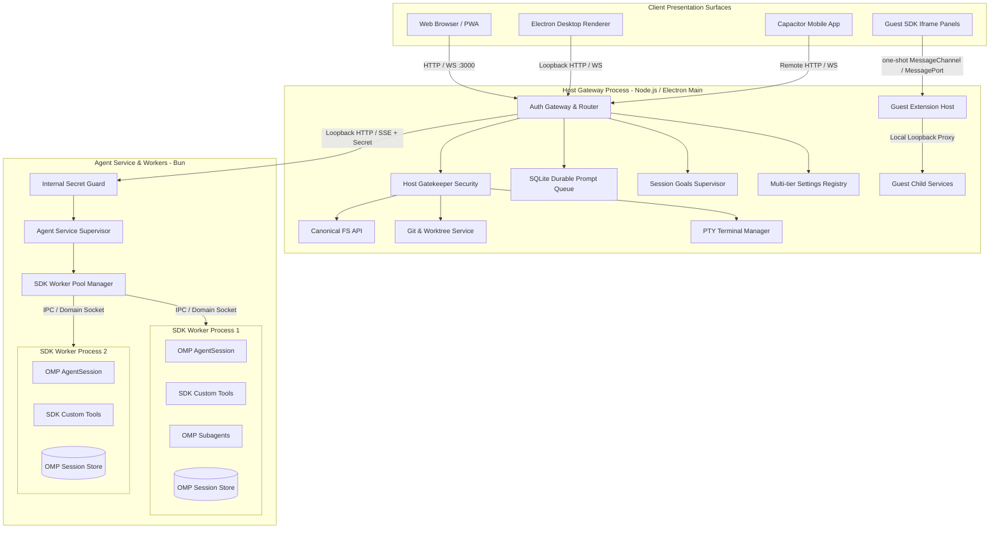
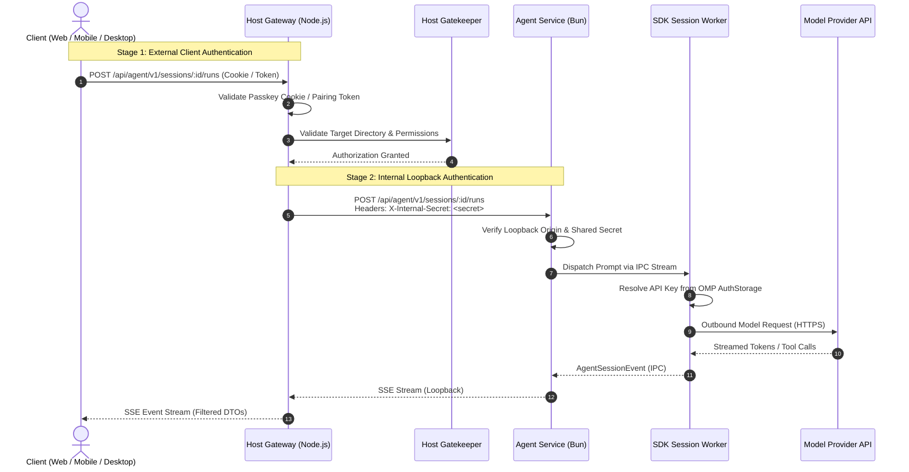
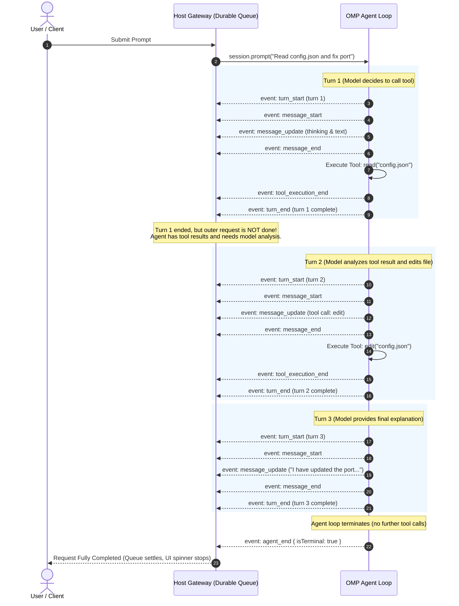

# Target architecture and system design

This document specifies the proposed target architecture, process topology, state ownership boundaries, and architectural decision records for OhPiChamber. The [refreshed-source traceability](scope.md#refreshed-source-traceability) records current inherited capabilities and the boundaries to migrate. The final target adopts Oh My Pi as the sole agent execution engine, replaces OpenCode runtime dependencies, and retires the VS Code extension form while retaining Web, Electron Desktop, Mobile and Guest SDK surfaces. Proposed process and package locations below are not implemented source paths.

## Document authority and precedence

When architectural requirements or implementation details conflict across documents, the following order of precedence governs:
1. Explicit user instructions.
2. [scope.md](scope.md) (product boundaries and retained surfaces).
3. [contracts.md](contracts.md) (protocol schemas and wire specifications).
4. [architecture.md](architecture.md) (this document: process topology, state ownership, and deployment boundaries).
5. [implementation-plan.md](implementation-plan.md) (milestone sequencing and execution gates).
6. [feature-inventory.md](feature-inventory.md) (historical baseline analysis).

Internal documentation links use direct filenames in the same folder:
- Overview: [README.md](README.md)
- Product scope and boundaries: [scope.md](scope.md)
- API and event contracts: [contracts.md](contracts.md)
- Implementation roadmap: [implementation-plan.md](implementation-plan.md)
- Baseline inventory: [feature-inventory.md](feature-inventory.md)

Codebase references point to paths relative to the repository root, such as `../../packages/ui` or `../../packages/web/server`.

---

## Architectural decision records (ADRs)

### ADR-01: Direct OMP SDK integration inside a dedicated Bun Agent Service

- **Context:** The inherited application interacts with OpenCode as an external HTTP server and proxy. Earlier SDK research identified OMP CLI RPC and a native TypeScript SDK. The exact installed version and service-safe APIs remain M0 inputs. OpenChamber requires multi-session management, fine-grained event subscriptions, rich tool cards, and streaming.
- **Decision:** Build a dedicated `packages/agent-service` running on Bun that integrates the OMP TypeScript SDK directly. Do not use OMP CLI RPC as the default runtime path. Do not support OpenCode as a secondary engine. Remove all multi-engine selectors and fallback branches.
- **Rationale:** The OMP SDK exposes programmatic primitives (`createAgentSession`, `session.prompt`, `session.subscribe`, `session.steer`, `session.abort`) with in-memory event dispatch. Running the SDK directly in Bun avoids child process serialization bottlenecks, allows custom tools to execute as normal async functions without stdin/stdout pipe round-trips, and provides direct access to OMP compaction and token accounting.
- **Consequences:** The Agent Service must run under Bun because OMP relies on Bun runtime primitives. The Node.js Host Gateway manages the Bun process as a trusted internal daemon.

### ADR-02: Strict process separation between Node.js Host Gateway and Bun Agent Service

- **Context:** OpenChamber's Host Gateway runs on Node.js (or embedded Node in Electron) and manages file systems, Git repositories, PTY terminals, passkey authentication, tunnels, and user preferences. The OMP SDK runs on Bun.
- **Decision:** Keep the Node.js Host Gateway and the Bun Agent Service as separate operating system processes. Expose the Canonical Agent API (`/api/agent/v1`) through the Host Gateway, which proxies requests to the Bun Agent Service over a loopback connection authenticated by an ephemeral shared secret.
- **Rationale:** Process separation isolates agent crashes, memory leaks, and native addon compilation issues from the core application shell. If an agent session exhausts memory or crashes Bun, the user's terminal sessions, editor tabs, and Git operations in the Host Gateway remain running. Node.js native addons like `node-pty` remain on their tested Node runtime without requiring Bun compatibility shims.
- **Consequences:** All client traffic passes through the Host Gateway. The Agent Service is bound strictly to `127.0.0.1` or a local UNIX domain socket and never listens on public network interfaces.

### ADR-03: Conservative session isolation via dedicated SDK worker processes

- **Context:** The OMP SDK contains process-level state. Specifically, `process.cwd()` is global to the OS process, the default `AgentRegistry` admits only one `Main` agent per generation, and `AsyncJobManager` and eval execution environments share module-level state. Multi-session concurrency inside a single process has not been formally verified in OMP.
- **Decision:** Adopt a conservative process-per-session worker architecture. The Bun Agent Service acts as a supervisor, spawning an isolated Bun SDK Worker process for each active session or workspace directory.
- **Rationale:** Running separate worker processes guarantees that different sessions with different working directories (`cwd`) never collide. Global singletons in OMP cannot leak between concurrent user sessions. If an individual worker crashes, sibling sessions continue uninterrupted.
- **Consequences:** Worker spawning introduces a small memory and startup overhead. A worker pool and idle hibernation policy manage resource usage. In-process multi-session isolation will only be evaluated after targeted concurrency probes pass in milestone M0.

### ADR-04: Single source of truth for transcripts and session state

- **Context:** Systems that wrap an external AI engine often attempt to duplicate session history in their own application database, creating desynchronization bugs during context compaction, branching, or rollbacks.
- **Decision:** OMP is the sole authority for the conversation transcript, execution events, tool results, and compaction history. OpenChamber Host Gateway owns the durable prompt queue, session goals checklist, scheduled tasks, and folder metadata. OpenChamber never maintains a second copy of the full conversation transcript.
- **Rationale:** OMP's `SessionManager` manages append-only transcript persistence on disk. Writing a second transcript in SQLite introduces synchronization latency, double writes, and ordering conflicts during compaction or aborts. The Agent Service projects OMP's transcript on demand into Canonical API Data Transfer Objects (DTOs).
- **Consequences:** Deleting an OMP session removes its underlying transcript file. Moving or renaming sessions in the UI updates metadata records in the Host database without mutating the internal OMP transcript file.
- **Current source versus target:** The inherited prompt queue uses atomic `message-queue.json` writes with a revision counter. The target SQLite queue is a later Host Gateway persistence cutover, not an existing implementation. Preserve ordered delivery, captured attachments, leases and explicit corrupt-file/failure handling while migrating it.

### ADR-05: Host Gatekeeper as the authoritative security boundary

- **Context:** OMP provides tool approval hooks, but its permission system cannot verify the full host environment, file traversal boundaries, or shell escape sequences. Furthermore, Guest extensions declare capabilities that must be strictly enforced.
- **Decision:** The Host Gatekeeper remains the primary, authoritative security boundary for all machine mutations. OMP approval events request user confirmation, but the Host Gatekeeper validates every file modification, path traversal, and command execution before running it.
- **Rationale:** The Host Gateway operates with the user's local permissions. Relying solely on model-level or SDK-level checks creates vulnerabilities if prompts are manipulated or SDK internal tools bypass checks. The Host Gatekeeper enforces canonical realpath verification, command injection filters, and environment stripping independently of the agent engine.
- **Consequences:** Even when an OMP tool call succeeds internally, any file system or execution operation performed via host bridges must clear Host Gatekeeper rules.

### ADR-06: Retirement of VS Code extension and dual-engine mechanisms

- **Context:** The inherited baseline still includes the VS Code extension package and OpenCode proxy abstractions. Their presence during the rebaseline is not final product support.
- **Decision:** Completely delete `packages/vscode` and all OpenCode compatibility layers. Retain external desktop editor launching (`vscode://`, `cursor://`, `windsurf://`) and VS Code theme importing in the Web and Electron surfaces.
- **Rationale:** Maintaining a VS Code webview extension alongside Web, Desktop, and Mobile surfaces triples maintenance cost. OpenChamber provides a complete standalone UI. Deleting OpenCode proxy code eliminates dead branches and prevents architectural drift.
- **Consequences:** Users run OhPiChamber as a Web application, PWA, Electron desktop application, or Capacitor mobile client. Clicking "Open in Editor" launches their preferred desktop IDE via operating system protocol handlers.

---

## System architecture and process topology

The system operates across three process tiers: the client presentation tier, the Host Gateway tier, and the Agent Service worker tier.



### Detailed process layout

```text
+---------------------------------------------------------------------------------------+
| CLIENT SURFACES (Web / PWA, Electron Renderer, Mobile Capacitor, Guest Iframes)       |
| - React 19 UI, TanStack Virtualizer, CodeMirror 6, Xterm.js                          |
| - Canonical Client connects via HTTP, WebSocket, and SSE to Host Gateway             |
+---------------------------------------------------------------------------------------+
                                        |
                 Public Network / Loopback (HTTP / WS on port 3000)
                 Authenticated by Session Cookie, Passkey, or Pairing Token
                                        v
+---------------------------------------------------------------------------------------+
| NODE.JS HOST GATEWAY (packages/web/server, Electron Main)                              |
| - Runtime: Node.js (or Electron embedded Node)                                        |
| - Public HTTP & WebSocket listener                                                    |
| - External Authentication: Passkey (WebAuthn), Session Cookie, Pairing v2 Handshake   |
| - Host Gatekeeper: Realpath canonicalization, command injection protection            |
| - Host Services: File system, Git, Worktree lifecycle, PTY terminal streaming         |
| - Autonomous Engines: Durable Prompt Queue (SQLite), Goals Supervisor, Task Loops    |
| - Extension Host: Iframe envelope manager, Guest child service process runner         |
| - Reverse Proxy: Routes /api/agent/v1/* to internal Bun Agent Service                 |
+---------------------------------------------------------------------------------------+
                                        |
                 Private Loopback IPC (UNIX Domain Socket or 127.0.0.1 TCP)
                 Authenticated by Ephemeral Secret (X-Internal-Secret)
                                        v
+---------------------------------------------------------------------------------------+
| BUN AGENT SERVICE SUPERVISOR (packages/agent-service)                                 |
| - Runtime: Bun                                                                        |
| - Internal Loopback HTTP, SSE, and WebSocket Server                                   |
| - Secret Verification Guard: Rejects non-loopback or unauthorized callers             |
| - SDK Worker Pool: Spawns, monitors, and terminates isolated SDK Worker processes     |
| - Catalog Projection: Exposes OMP models, thinking levels, and settings schemas       |
| - Session Directory Mapping: Maps canonicalSessionId to ompSessionId and worker PID  |
+---------------------------------------------------------------------------------------+
                                        |
                 Worker IPC (Parent-Child Process Pipe / Domain Socket)
                                        v
+---------------------------------------------------------------------------------------+
| ISOLATED SDK WORKER PROCESS (1 process per active session or workspace)                |
| - Runtime: Bun                                                                        |
| - Isolated process.cwd() bound to session workspace or worktree directory             |
| - Dedicated AgentRegistry (admitting independent Main agent)                          |
| - OMP AgentSession instance (createAgentSession from @oh-my-pi/pi-coding-agent/sdk)   |
| - SDK Custom Tools: read, bash, edit, write, memory, ask, task (function calls)       |
| - Event Dispatch: Emits AgentSessionEvents over IPC stream to Supervisor              |
| - Transcript Storage: Writes directly to OMP session file (~/.omp/agent/sessions/...) |
+---------------------------------------------------------------------------------------+
```

---

## Module ownership and responsibility matrix

The table below defines ownership, runtime environments, source code locations, and boundary rules across all architectural tiers.

| Subsystem | Owning Tier | Runtime / Process | Source Path (Current / Target) | Responsibilities and Authority | Invariants and Boundary Rules |
|---|---|---|---|---|---|
| User Interface Components | Client Presentation | Browser / Electron Renderer | `packages/ui/src` | Renders chat timeline, diffs, composer, terminal tabs, file tree, settings. | Must never import Node.js, Bun, or OMP SDK packages directly. |
| Canonical Client SDK | Client Presentation | Browser / Electron Renderer | `packages/ui/src/api`, proposed | Client library consuming `/api/agent/v1` and host APIs. | Cut over all current `@opencode/client`/`@opencode/schema` callers; expose no engine types. |
| Desktop Shell | Client Presentation | Electron Native Main | `packages/electron` | Frameless window, Quake mode, Mini Chat, system tray, native dialogs, auto-updater and app menus. | Runs Host Gateway in-process; Agent Service remains a separate Bun process. |
| Mobile Shell | Client Presentation | Capacitor (iOS / Android) | `packages/mobile` | Mobile drawer layout, QR pairing, secure storage, APNs/FCM push handlers. | Communicates over network; does not run local Node or Bun processes. |
| Host Authentication | Host Gateway | Node.js / Electron Main | `packages/web/server/lib/host/auth*` | Passkey (WebAuthn), session cookies, pairing tokens, brute-force rate limits. | Authoritative gate for all incoming client connections. |
| Host Gatekeeper | Host Gateway | Node.js / Electron Main | `packages/web/server/lib/host/gatekeeper*` | Canonical realpath checks, symlink denial, shell command injection sanitization. | Authoritative boundary; blocks dangerous operations before execution. |
| Filesystem Service | Host Gateway | Node.js / Electron Main | `packages/web/server/lib/host/fs*` | Directory trees, file read and write, partial content streaming (HTTP 206). | Resolves paths via realpath; rejects escapes outside workspace root. |
| Git and Worktree Service | Host Gateway | Node.js / Electron Main | `packages/web/server/lib/host/git*` | Status, diff, commit, push, pull, worktree creation and cleanup. | Sets `GIT_TERMINAL_PROMPT=0`; blocks root directories (`/`, `$HOME`). |
| PTY Terminal Service | Host Gateway | Node.js / Electron Main | `packages/web/server/lib/host/pty*` | Manages `node-pty` processes, circular scrollback buffer, WebSocket streaming. | Strips dangerous environment variables; 20-second SIGKILL cleanup. |
| Durable Prompt Queue | Host Gateway | Node.js / Electron Main | `packages/web/server/lib/host/queue*` | SQLite persistence for user prompts queued while session is busy or offline. | Strict FIFO dispatch on session idle; survives client disconnects. |
| Goals Supervisor | Host Gateway | Node.js / Electron Main | `packages/web/server/lib/host/goals*` | Goal persistence, post-turn verification loop, automated next-step prompt. | Circuit breaker trips after three failed cycles without progress. |
| Scheduled Task Engine | Host Gateway | Node.js / Electron Main | `packages/web/server/lib/host/scheduler*` | CRON and interval task execution, distributed claim locking. | Stored in `.agents/loops/`; claims lock to prevent duplicate runs. |
| Multi-tier Settings | Host Gateway | Node.js / Electron Main | `packages/web/server/lib/host/settings*` | Four-tier hierarchy: Instance, Profile, Device, Surface. | Preserved from `lib/opencode`; stored in `~/.config/ohpichamber/`. |
| Themes and Unpacker | Host Gateway | Node.js / Electron Main | `packages/web/server/lib/host/themes*` | Theme catalog, VS Code `.vsix` archive unpacker, token persistence. | Preserved from `lib/opencode`; imports VS Code themes cleanly. |
| Guest Extension Host | Host Gateway | Node.js / Electron Main | `packages/web/server/lib/guests*` | Manifest validation, sandbox iframe envelope, capability granting. | Enforces manifest permissions; passes whitelisted environment only. |
| Guest Service Spawner | Host Gateway | Node.js / Electron Main | `packages/web/server/lib/guests/service*` | Spawns background helper processes for extensions declaring `service`. | Runs as child process; does not have an OS sandbox; user must approve. |
| Agent Supervisor | Agent Service | Bun Process | `packages/agent-service/src/supervisor` | Loopback listener, internal secret guard, worker lifecycle, routing. | Listens on loopback only; authenticates caller via internal secret. |
| SDK Worker Pool | Agent Service | Bun Process | `packages/agent-service/src/pool` | Spawns worker processes, manages worker recycling, monitors health. | Recycles workers after idle timeout or unrecoverable error. |
| SDK Session Worker | Agent Worker | Bun Child Process | `packages/agent-service/src/worker` | Creates `AgentSession`, hosts OMP loop, registers SDK custom tools. | Dedicated `cwd`; dedicated `AgentRegistry`; isolated memory heap. |
| OMP Core Engine | Agent Worker | Bun Library | `@oh-my-pi/pi-coding-agent` | Agent loop, model calling, context compaction, tool execution, telemetry. | Authoritative transcript owner; persists to `~/.omp/agent/sessions/`. |
| Guest Extension SDK | External Extensions | Browser / Host Bridge | `packages/sdk` | Third-party extension contract, UI kit, one-shot `MessageChannel` bootstrap and `MessagePort` bridge. | Sandboxed iframe; receives a port only after an authorized document's early bootstrap and cannot call internal agent APIs directly. |

Current host ownership is not confined to the proposed `lib/host/*` paths above. Filesystem, Git, PTY, Guest, Board/provider integrations and environment overlays already have owning host modules. Extract host-owned startup/settings/theme/auth wiring from `lib/opencode` before deleting the agent integration, and keep existing owning modules in place unless their boundary actually changes. The settings registry currently persists instance and profile data separately; Quake and Mini Chat use native IPC. Source-aware additions and acceptance are owned by `scope.md`, not by a second architecture inventory.

---

## SDK versus RPC runtime selection and rationale

The target architecture uses the OMP TypeScript SDK directly within a dedicated Bun service rather than running the OMP CLI in RPC mode (`omp --mode rpc`). This decision rests on verified source code evidence.

### Verified source code facts

1. **OMP SDK Structure (`@oh-my-pi/pi-coding-agent/src/sdk.ts`):**
   - The SDK exports `createAgentSession(options: CreateAgentSessionOptions): Promise<CreateAgentSessionResult>`.
   - Custom tools are registered through `customTools?: (CustomTool | ToolDefinition)[]`. Each custom tool defines an `execute: async (toolCallId, params, signal, onUpdate, ctx) => ...` function. Tool execution in the SDK is a direct asynchronous function call within the runtime.
   - The session exposes programmatic control: `session.prompt()`, `session.steer()`, `session.followUp()`, `session.abort()`, and `session.subscribe(listener)`.
   - Event subscription receives strongly typed `AgentSessionEvent` objects containing tokens, tool execution progress, thinking levels, compaction results, and errors.
   - Line 726 of `src/sdk.ts` explicitly documents:
     ```typescript
     // Agent registry: pass a private instance per `createAgentSession` when
     // embedding several concurrent top-level sessions in one process (the default
     // global registry admits only one "Main" per process generation).
     export { type AgentRef, AgentRegistry, MAIN_AGENT_ID } from "./registry/agent-registry";
     ```

2. **OMP RPC Mode Structure (`@oh-my-pi/pi-coding-agent/src/modes/rpc/`):**
   - RPC mode operates over `process.stdin` and `process.stdout` using newline-delimited JSON messages (`rpc-input.ts`, `rpc-output.ts`).
   - `rpc-mode.ts` maintains a single active session reference (`this.session`). Switching sessions requires sending `switch_session` commands.
   - Tool execution by the host requires the RPC server to emit `{ type: "host_tool_call", id, toolCallId, toolName, arguments }` over stdout. The host must process the command and return `{ type: "host_tool_result", id, result, isError }` over stdin (`rpc-types.ts:455-483`).
   - An RPC subprocess manages exactly one interactive session at a time on its standard I/O streams.

### Functional and architectural comparison

| Dimension | OMP TypeScript SDK (`sdk.ts`) | OMP CLI RPC Mode (`--mode rpc`) |
|---|---|---|
| Invocation Model | Programmatic library import in Bun. | Subprocess spawned with stdin and stdout pipes. |
| Tool Execution Mechanism | Direct async JavaScript function calls in worker. | Round-trip JSON lines over stdin and stdout (`host_tool_call`). |
| Serialization Overhead | Zero serialization for tool execution arguments. | Double JSON stringify and parse for every tool call and result. |
| Event Streaming Granularity | Direct object references passed to listeners. | Serialized JSON lines streamed over stdout pipe. |
| Session Lifecycle Control | Fine-grained instantiation, fork, branch, compact. | Coarse-grained command set (`new_session`, `switch_session`). |
| Multi-session Concurrency | Multiple sessions instantiated across worker processes. | One active session per subprocess on stdin and stdout. |
| Failure Modes | Structured exceptions caught at function boundary. | Broken pipe, unhandled process crash, corrupted JSON framing. |
| Memory Overhead | Lean worker footprint sharing common module graph. | Full Node/Bun CLI bootstrap overhead per RPC instance. |

### Architectural conclusion

The OMP SDK is chosen because it allows OhPiChamber to embed agent capabilities as native code. The Agent Service registers tools as in-memory async functions, receives events through typed in-process subscriptions, and projects state directly into the Canonical API.

RPC mode is not used as a primary or secondary architecture because wrapping an interactive CLI subprocess behind an HTTP server adds serialization latency, creates fragile standard I/O pipe management, and complicates concurrent multi-session routing. OhPiChamber will maintain a single runtime implementation based on the OMP SDK.

---

## Authentication, credential boundary, and request flow

The architecture enforces a strict two-stage authentication perimeter. External users never communicate directly with the Agent Service.



### Detailed credential boundaries

1. **Client to Host Gateway Credentials:**
   - Web clients authenticate using HTTP-only, SameSite cookies established during password or WebAuthn (Passkey) login.
   - Remote mobile and desktop clients authenticate using long-lived Bearer pairing tokens created via QR code handshake.
   - The Host Gateway verifies credentials on every request before routing to any service.

2. **Host Gateway to Agent Service Internal Credentials:**
   - When the Host Gateway spawns the Bun Agent Service, it generates a 256-bit cryptographically secure random token (`crypto.randomBytes(32).toString('hex')`).
   - The token passes to the Agent Service via the environment variable `OHPICHAMBER_INTERNAL_SECRET`.
   - The Agent Service binds only to `127.0.0.1` or a private UNIX domain socket.
   - Every internal HTTP request from the Host Gateway includes the header `X-Internal-Secret: <token>`. Requests without this header or from non-loopback addresses are rejected immediately with HTTP 403 Forbidden.

3. **Model Provider Credentials:**
   - Model provider API keys and OAuth tokens (Anthropic, OpenAI, GitHub Copilot, Google) reside in OMP's `AuthStorage` (SQLite database `agent.db` at `getAgentDbPath()`, e.g. `~/.omp/agent/agent.db`).
   - Keys are loaded strictly inside the SDK Session Worker process when initiating outbound requests to AI providers.
   - Provider credentials are never transmitted to client browsers, never sent across the public network, and never exposed in Canonical API responses.

---

## Process lifecycle: startup readiness, version negotiation, termination, and crash recovery

### Startup and readiness pipeline

The Host Gateway and Agent Service follow an ordered lifecycle sequence during application startup:

1. **Host Gateway Initialization:**
   - Node.js loads configuration from `~/.config/ohpichamber/settings.json`.
   - Host Gatekeeper initializes path resolution rules.
   - SQLite databases open for the durable message queue and session metadata.
   - HTTP and WebSocket server starts on the configured external port (default: 3000).
2. **Agent Service Spawn:**
   - Host Gateway verifies that the `bun` binary exists on the system PATH or in configured runtime paths.
   - Host Gateway generates the ephemeral shared secret and starts the Bun Agent Service:
     ```bash
     bun packages/agent-service/src/index.ts --port 0 --secret <secret>
     ```
   - Passing `--port 0` prompts the operating system to allocate an ephemeral free port, eliminating port conflict issues.
3. **Readiness Probe:**
   - The Agent Service initializes its HTTP server and verifies that the OMP SDK can be imported and initialized.
   - The Agent Service writes its assigned port and readiness status to stdout in a structured JSON line: `{"status":"ready","port":48123}`.
   - The Host Gateway reads the port from stdout, establishes a loopback connection, and performs a health check query: `GET /api/agent/v1/ready`.
   - If the Agent Service fails to report readiness within 15 seconds, the Host Gateway logs an error, marks agent capabilities as unavailable, and exposes an error banner in the client UI.

### Version and capability negotiation

Clients negotiate capabilities with the Host Gateway upon connection:
- Client sends `GET /api/agent/v1/capabilities`.
- The Host Gateway combines its own capabilities (file streaming, terminal support) with the Agent Service capabilities (model routing, subagents, mid-turn steering).
- The returned payload specifies supported features:
  ```json
  {
    "version": "1.0.0",
    "engine": "omp",
    "capabilities": {
      "streaming": true,
      "casApprovals": true,
      "midTurnSteering": true,
      "followUpQueue": true,
      "subagents": true,
      "sessionBranching": true
    }
  }
  ```
- If a client requests an unsupported capability (such as an obsolete OpenCode command), the server returns HTTP 501 (`NOT_IMPLEMENTED`) or HTTP 400 (`UNSUPPORTED_CAPABILITY`) with a structured RFC 7807 problem detail. It never accepts calls silently.

### Termination and graceful shutdown

When the user exits the application or issues a shutdown command:
1. Host Gateway stops accepting new incoming client requests.
2. Host Gateway sends a shutdown signal (`POST /api/agent/v1/shutdown` with internal secret) to the Agent Service.
3. The Agent Service instructs all active SDK Workers to abort in-flight turns cleanly and persist transcript state.
4. Active workers are given up to 5 seconds to finish writing session files.
5. If the Agent Service or child workers do not terminate after 10 seconds, the Host Gateway issues `SIGTERM`, followed by `SIGKILL` after an additional 2 seconds.

### Crash recovery and fault tolerance

The multi-tier process model prevents single-point failures from compromising the entire system:

1. **SDK Worker Crash (Per-session isolation):**
   - If an SDK Worker crashes due to an out-of-memory condition or unhandled native error, the Bun Agent Supervisor detects child process exit.
   - The Supervisor records the exit code and marks the session state as `error` with error code `SESSION_WORKER_CRASHED`.
   - An error event streams to the connected client. Sibling sessions running in other worker processes continue without interruption.
   - When the user submits a new prompt or clicks retry, the Supervisor spawns a fresh SDK Worker. The new worker calls `createAgentSession` with `continueSession: true`, restoring session history from the OMP transcript file.
2. **Bun Agent Service Supervisor Crash:**
   - If the main Bun Agent Service process crashes, the Node.js Host Gateway detects child exit via `child_process` event handlers.
   - The Host Gateway updates its internal service health state to `degraded`.
   - Incoming requests to `/api/agent/v1/*` return HTTP 503 (`AGENT_SERVICE_UNAVAILABLE`).
   - The Host Gateway initiates automatic restart of the Agent Service with exponential backoff (initial retry at 1s, doubling up to 15s, maximum 3 retries).
   - Once restarted, clients reconnect and resume streaming without requiring an application restart.

---

## Working directory, session, and subagent isolation

### Concurrency hazards in process-level state

Investigation of the OMP codebase reveals several shared state mechanisms that make running multiple concurrent sessions inside a single process risky:

1. **Global `process.cwd()`:**
   Both Node.js and Bun maintain a single process-wide current working directory. If Session A operates in `/workspace/project-a` and Session B operates in `/workspace/project-b`, any tool or internal library relying on `process.cwd()` experiences race conditions when sessions execute concurrently.
2. **`AgentRegistry` Singleton:**
   In `@oh-my-pi/pi-coding-agent/src/registry/agent-registry.ts`, the default global registry allows only one `Main` agent per generation. While `createAgentSession` accepts a custom `agentRegistry`, subagent spawning and IRC peer routing historically interact with process-level singletons unless carefully scoped.
3. **Execution Sandboxes (`eval`):**
   The Python kernel and JavaScript VM context managers in `@oh-my-pi/pi-coding-agent/src/eval/` maintain session-scoped state that must be strictly cleaned up across session disposals.

### The isolated worker process architecture

To eliminate these hazards, OhPiChamber enforces worker-level process isolation for sessions:

```text
Bun Agent Supervisor
  |
  +-- Worker Process 1 (PID 40101)
  |     - process.cwd = /home/user/project-alpha
  |     - AgentRegistry: private instance (Main = sess_alpha)
  |     - Active Session: sess_alpha
  |     - Child Subagent: sub_research (spawned via task tool)
  |
  +-- Worker Process 2 (PID 40102)
        - process.cwd = /home/user/project-beta/worktree-feature
        - AgentRegistry: private instance (Main = sess_beta)
        - Active Session: sess_beta
```

- Each worker process executes with its own operating system working directory (`cwd`) set to the project root or Git worktree path.
- Subagents spawned by a session (via the OMP `task` tool) execute inside the same worker process as their parent session. They inherit the parent's `subagentEventBus`, share the worker's private `AgentRegistry`, and communicate across IPC without affecting other projects.
- Workers that remain idle for longer than the configured pool timeout (default: 15 minutes) are terminated gracefully after saving state, freeing system memory.

---

## State authority, transcript persistence, and identifier mapping

OhPiChamber enforces clear ownership boundaries between OMP and OpenChamber databases.

### State ownership separation

```text
+------------------------------------+      +------------------------------------+
| OPENCHAMBER HOST GATEWAY DATABASE  |      | OMP AGENT TRANSCRIPT STORE         |
| (SQLite: ~/.config/ohpichamber/...) |      | (JSON Lines: ~/.omp/agent/...)     |
+------------------------------------+      +------------------------------------+
| 1. Session Metadata:               |      | 1. Message History:                |
|    - canonicalSessionId            |      |    - User prompt turns             |
|    - ompSessionId                  |      |    - Assistant reasoning parts     |
|    - displayTitle                  |      |    - Tool call inputs & outputs    |
|    - projectId & worktreePath      |      |    - Compaction summaries          |
|    - folderId & pinnedState        |      | 2. Execution State:                |
|    - createdAt & updatedAt         |      |    - Token usage metrics           |
| 2. Durable Prompt Queue:           |      |    - Step & turn indices           |
|    - Pending prompt text & parts   |      |    - Stop reasons & error states   |
|    - Enqueued timestamp & status   |      | 3. Subagent Transcript:            |
| 3. Session Goals Checklist:        |      |    - Task delegation outputs       |
|    - Goal criteria & status        |      |    - Inter-agent messages          |
| 4. Scheduled Loops & Multi-run     |      +------------------------------------+
+------------------------------------+                        |
                  |                                           |
                  +---------------------+---------------------+
                                        |
                                        v
                 Projected on-the-fly into Canonical API DTOs
                 (SessionDetail, MessageRecord, TurnDTO)
```

- **OMP owns the transcript:** All conversation text, assistant reasoning blocks, tool inputs, tool execution outputs, context compactions, and token counts are stored in OMP's native session files. OpenChamber never duplicates these records into a second transcript table.
- **Host Gateway owns operational metadata:** The Host SQLite database tracks UI folders, custom titles, pin status, project associations, and Git worktree bindings.
- **Single Writer Rule:** Only OMP writes to OMP transcript files. Only the Host Gateway writes to the metadata database. The Agent Service acts as a read-only projector, transforming OMP transcript events into Canonical DTOs during queries and streaming.

### Identifier mapping

To insulate client surfaces from internal engine paths, the system maintains a strict identifier mapping:

| Entity | Client Identifier (Canonical) | Engine Identifier (OMP) | Mapping Location |
|---|---|---|---|
| Session | `canonicalSessionId` (UUID v4) | `ompSessionId` (Snowflake string) | Host SQLite `sessions` table |
| Message Part | `partId` (UUID v4) | Internal message index / toolCallId | Generated deterministically during projection |
| Turn | `turnIndex` (0-indexed integer) | OMP turn generation index | 1:1 mapped from OMP `turnIndex` |
| Subagent | `subagentId` (UUID v4) | OMP AgentRef ID (`sub_...`) | Host runtime session map |

---

## Model catalog, provider OAuth, MCP, and skills migration

### Model catalog and selection

The inherited host enriches model discovery with `lib/opencode/models-metadata.js`, `model-discovery.js`, `providers.js` and shared config schemas. These are current migration inputs, not an OMP catalog implementation.

In the target OhPiChamber architecture, subject to M0 verification:
- The model catalog maps directly to OMP's `ModelRegistry` (`@oh-my-pi/pi-coding-agent/src/config/model-registry.ts`) and `@oh-my-pi/pi-ai`.
- The endpoint `GET /api/agent/v1/models` queries OMP's registry, returning models grouped by provider with token window limits, reasoning effort support, and tool calling capabilities.
- Model restoration on session load/resume: When opening or switching an existing session via `createAgentSession` or `switchSession`, if the session's recorded model is no longer available in the local registry, OMP throws `Could not restore model <provider/id>`. The Agent Service handles this failure explicitly by mapping it to a canonical error (`SESSION_RESTORE_FAILED`) or accepting an updated model selector, rather than assuming silent degradation.
- Model aliases (such as `openchamber/auto`) are resolved by the Host Gateway's intent router before dispatching to OMP.

### Provider credentials and quota migration

- The current host's `lib/opencode/auth.js` reads stored credentials through `GET /api/credential` and managed environment connections through `GET /api/integration`. Credential responses contain secrets and remain host-only. External-runtime environment values are unavailable, not authoritative empty credentials. The projected legacy auth-entry shape does not mean the host still reads `auth.json`.
- Earlier OMP research identified SQLite `agent.db` and `AuthStorage`. M0 must verify the exercised SDK's path, API/OAuth fields and supported provider conversions before the importer is implemented.
- **One-time migration boundary:** M1 supplies a user-triggered importer from documented available credential records to verified OMP AuthStorage and OhPiChamber settings. Resolve each provider separately, report unsupported or unavailable records as requiring re-authentication, never export secrets to the browser, and remove the importer after the cutover. It is not a permanent OpenCode reader, compatibility API or startup action. Historical credential files are optional explicitly selected inputs, not the sole refreshed-source contract.
- **Quota tracking migration:** Host quota modules retain provider billing ownership but consume credentials through the OMP-owned boundary after cutover. Do not leave the OpenCode accessor or legacy entry aliases as a fallback.
### Model Context Protocol (MCP) integration

- The inherited config writers persist OpenCode `mcp.servers` entities immediately and rely on its file watcher to apply changes. The current mutation response does not restart the daemon. Replace that format and lifecycle at cutover, not a presumed mandatory restart workflow.
- Earlier OMP research identified `MCPManager` with stdio, SSE and HTTP transports. M0 must verify its live reload and shutdown behavior before freezing the service integration.
- MCP configurations are saved in `~/.config/omp/mcp.json` or workspace `.omp/mcp.json`.
- The Agent Service passes the configured `MCPManager` directly to `createAgentSession({ enableMCP: true, mcpManager })`. Tools provided by MCP servers are discovered during session startup and injected into the agent loop.

### Skills management

- The inherited command/skill catalog remains an OpenCode integration boundary. Replace its discovery and configuration callers together, preserving installed standard skills rather than assuming the old prompt-template inventory is exhaustive.
- OMP natively supports the standard `SKILL.md` format (`@oh-my-pi/pi-coding-agent/src/extensibility/skills.ts`).
- Skills are discovered from:
  - Global user skills: `~/.config/omp/skills/`
  - Workspace skills: `.agents/skills/` and `.omp/skills/`
- The Composer autocomplete menu and slash command suggestions read directly from OMP's skill discovery mechanism.

---

## Turn lifecycle semantics: turn_end versus outer request completion

A critical invariant in the agent loop architecture is the distinction between a model generation turn and an outer user request turn.



### Protocol invariant rules

1. `turn_end` signals the end of a single model request and its corresponding tool executions. It does not indicate that the user's prompt has been fully answered.
2. If the assistant called a tool during a turn, the OMP agent loop automatically initiates the next turn to feed the tool results back into the model.
3. The outer user request completes only when the OMP agent emits `agent_end` with `isTerminal: true`.
4. If `agent_end` arrives with `isTerminal: false`, an asynchronous background job is pending that will resume execution. The session remains busy.
5. The Host Gateway durable prompt queue and client UI spinner must stay in the `running` state until `agent_end` with `isTerminal: true` is received, or an explicit abort or unrecoverable error occurs.

---

## Guest extension boundary and tool capabilities

OpenChamber supports third-party extensions via `@openchamber/sdk` (`packages/sdk`). The relationship between guest extensions, tools, and the OMP agent runtime is strictly bounded.

### Verified facts from baseline codebase

1. **`contributes.tools` is Display Metadata Only:**
   In `packages/sdk/src/manifest.ts` and `packages/sdk/DOCUMENTATION.md` (line 45):
   ```text
   contributes.tools is 1 to 16 entries (GUEST_TOOLS_MAX) that say how the extension's
   tool calls look in the chat, without code. match is the full tool name as OpenCode
   reports it, un-normalized (mcp.jira.search, jira_search)...
   ```
   An extension declaring `contributes.tools` provides only formatting instructions (icon, header title, parameter formatting) for tool call cards in the UI timeline. It contains no executable JavaScript or WebAssembly tool handler.
2. **`contributes.service` Has No Operating System Sandbox:**
   In `packages/sdk/GUEST_SERVICES.md` (lines 27-28 and 93):
   ```text
   Declared sockets / exec are shown on the grant card and do not confine the process;
   there is no sandbox for services. A service runs with the user's full access.
   ```
   Guest services run as child processes spawned by the Host Gateway using `ELECTRON_RUN_AS_NODE` or system Node. They inherit user privileges and can access the network and local file system.
3. **OMP Permissions Cannot Promise Unverified Coverage:**
   OMP's internal permission checks and approval hooks cover its own built-in tools (`read`, `bash`, `edit`, `write`). They do not provide sandbox confinement for external guest processes.

### Architectural boundary rules

- Guest extensions cannot inject executable tools directly into the OMP agent loop without Host Gateway validation.
- All file access requested by guest iframe panels (`readFile`, `writeFile`, `listDir`) passes through the Host Gateway's `lib/guests/` bridge, enforcing manifest capability checks (`files`, `filesystem`) and path realpath canonicalization.
- The UI timeline uses `contributes.tools` declarations solely to format tool cards visually. Execution of the tool itself remains within OMP or MCP servers.

---

## Security architecture and defense in depth

OhPiChamber enforces security across five defensive layers:

```text
[Layer 1: Network & Origin] ---> [Layer 2: Host Gatekeeper] ---> [Layer 3: Process Isolation]
  - Loopback binding only          - Realpath canonicalization     - Node vs Bun process boundary
  - Ephemeral shared secret        - Symlink escape rejection      - Per-session Bun SDK workers
  - Host header verification       - Command injection filters     - Clean process tree teardown

                                  [Layer 4: Privilege & Env] ---> [Layer 5: Output Sanitization]
                                    - Dangerous env stripping       - Linear URL sanitization
                                    - GIT_TERMINAL_PROMPT=0         - Secret pattern scrubbing
                                    - Non-root execution checks     - RFC 7807 structured errors
```

1. **Network Perimeter:**
   - The Agent Service listens only on `127.0.0.1` or a UNIX domain socket.
   - All internal requests require the 256-bit `X-Internal-Secret` token.
   - Host header rebinding protection rejects external requests spoofing localhost headers.
2. **Host Gatekeeper (File and Command Defense):**
   - Every file path undergoes `fs.realpath` verification before opening. Paths resolving outside the canonical workspace root return HTTP 403 Forbidden. Symlink escapes are rejected.
   - Shell command strings undergo syntax parsing to detect command chaining, subshells (`$(...)`, backticks), and attempts to access sensitive system directories (`/etc`, `~/.ssh`, `~/.gnupg`).
3. **Process and Environment Sanitization:**
   - Before spawning child processes (PTY terminals, Git commands, guest services), the host strips dangerous runtime variables including `NODE_CHANNEL_FD`, `ELECTRON_RUN_AS_NODE`, `LD_PRELOAD`, and internal cloud credentials.
   - Git operations set `GIT_TERMINAL_PROMPT=0` to prevent hanging on interactive credential prompts.
   - Terminal sessions enforce a 20-second timeout after `SIGTERM` before issuing `SIGKILL` to clean up the entire child process tree.
4. **Data Sanitization and Secret Protection:**
   - Linear and GitHub integration modules scan outgoing issue comments, scrubbing `localhost`, `127.0.0.1`, private IP subnets, and API key patterns before transmission.
   - Model provider keys in `AuthStorage` are never included in API responses or log messages.

---

## Host infrastructure preservation in lib/opencode

A critical requirement of the migration is avoiding destructive wholesale deletion of `packages/web/server/lib/opencode/`. Although named `opencode`, this directory contains core host features that are independent of the OpenCode engine.

### Modules to extract and preserve

The following modules must be extracted to `packages/web/server/lib/host/` during milestone M1 before OpenCode proxy code is deleted:

| Existing File Path | New Target Path | Reason for Preservation |
|---|---|---|
| `lib/opencode/settings-runtime.js` | `lib/host/settings-runtime.js` | Core settings engine managing the four-tier settings hierarchy. |
| `lib/opencode/settings-registry.json` | `lib/host/settings-registry.json` | JSON schema registry for application settings. |
| `lib/opencode/settings-files.js` | `lib/host/settings-files.js` | Atomic file read and write operations for user settings. |
| `lib/opencode/settings-helpers.js` | `lib/host/settings-helpers.js` | Helper functions for settings merging and default fallbacks. |
| `lib/opencode/settings-normalization-runtime.js` | `lib/host/settings-normalization-runtime.js` | Normalization of legacy and platform-specific settings keys. |
| `lib/opencode/theme-catalog.js` | `lib/host/theme-catalog.js` | UI theme discovery and active theme persistence. |
| `lib/opencode/theme-runtime.js` | `lib/host/theme-runtime.js` | Theme application runtime and CSS token generation. |
| `lib/opencode/theme-archive.js` | `lib/host/theme-archive.js` | Unpacks and imports VS Code `.vsix` theme packages. |
| `lib/opencode/tunnel-auth.js` | `lib/host/tunnel-auth.js` | Authentication guards for remote relays and dev tunnels. |
| `lib/opencode/tunnel-wiring-runtime.js` | `lib/host/tunnel-wiring-runtime.js` | Loopback tunnel wiring for Cloudflare and ngrok tunnels. |
| `lib/opencode/pwa-manifest-routes.js` | `lib/host/pwa-manifest-routes.js` | Generates dynamic web application manifest for PWA installs. |
| `lib/opencode/project-icon-routes.js` | `lib/host/project-icon-routes.js` | Serves project and workspace root favicon icons. |
| `lib/opencode/project-directory-runtime.js` | `lib/host/project-directory-runtime.js` | Tracks recent project workspaces and directory roots. |
| `lib/opencode/network-runtime.js` | `lib/host/network-runtime.js` | Local network interface detection and host rebinding protection. |
| `lib/opencode/login-shell-env.js` | `lib/host/login-shell-env.js` | Extracts system shell environment variables for PTY and commands. |
| `lib/opencode/server-startup-runtime.js` | `lib/host/server-startup-runtime.js` | Server initialization pipeline and port binding. |
| `lib/opencode/startup-pipeline-runtime.js` | `lib/host/startup-pipeline-runtime.js` | Step-by-step startup hooks for host services. |
| `lib/opencode/static-routes-runtime.js` | `lib/host/static-routes-runtime.js` | Serves static UI assets, fonts, and icons. |
| `lib/opencode/shutdown-runtime.js` | `lib/host/shutdown-runtime.js` | Graceful shutdown hooks and process cleanup. |
| `lib/opencode/managed-process-registry.js` | `lib/host/managed-process-registry.js` | Tracks background processes and guarantees exit cleanup. |
| `lib/opencode/snippets.js` | `lib/host/snippets.js` | Code snippet definitions for in-app editors. |
| `lib/opencode/watcher.js` | `lib/host/watcher.js` | File system watcher integration for UI updates. |

### Modules to delete (OpenCode-specific)

The following files contain pure OpenCode logic and will be deleted after host modules are moved:
- `lifecycle.js`, `lifecycle-process.test.js`: OpenCode binary downloader and process supervisor.
- `proxy.js`, `proxy.test.js`: Reverse proxy routing requests to OpenCode HTTP ports.
- `opencode-resolution-runtime.js`: Resolves system OpenCode binary paths.
- `routes-directory.test.js`: Tests for OpenCode directory-scoped proxies.
- `config-entity-routes.js`, `config-mutation-response.js`: OpenCode JSON configuration routes.

---

## Cross-platform deployment and cutover strategy

OhPiChamber supports four primary distribution targets without supporting dual-engine execution.

### Surface deployment topologies

1. **Web Application / Progressive Web App (PWA):**
   - Node.js Host Gateway runs as a standalone daemon on a local machine or server (`openchamber serve`).
   - The user opens the web application in any modern browser.
   - PWA service workers cache UI assets for offline launch; data syncs once the connection to the Host Gateway resumes.
2. **Electron Desktop Application:**
   - Packaged Electron application bundles the Node.js Host Gateway and the Bun Agent Service.
   - Electron Main launches the Host Gateway in-process on loopback port 0.
   - The desktop renderer window loads UI assets via the custom protocol `openchamber-ui://`.
   - External editor launches (`vscode://`, `cursor://`) execute via Electron `shell.openExternal`.
3. **Mobile Shell (Capacitor on iOS / Android):**
   - Native Capacitor wrapper bundles the React UI.
   - Connects to a remote or local Host Gateway via QR code pairing v2.
   - Receives native push notifications via APNs and FCM when agent turns complete or approvals are required.
4. **Guest Extension Runtime:**
   - Extensions run in sandboxed iframes within the Web or Electron surface.
   - Extensions bootstrap through a one-shot `MessageChannel` transferred after an authorized iframe document load, then communicate exclusively over the resulting `MessagePort` with the Host Gateway bridge. Window protocol messages are ignored after bootstrap; an unapproved self-navigation is not reconnected.

### Cutover strategy

The transition to OhPiChamber follows a clean cutover model across six milestones:
- `M0`: Capability verification and contract finalization.
- `M1`: Host boundary extraction and VS Code extension retirement.
- `M2`: OMP SDK service execution closure and security boundaries.
- `M3`: UI data layer cutover to Canonical Client.
- `M4`: Advanced autonomous features (Goals, Assist, Queue, Scheduler, Routing).
- `M5`: Retained surface verification and production release.

At no point will a public release contain both OpenCode and OMP options. Each module cutover immediately deletes its legacy OpenCode code path.

---

## Facts versus design assumptions and risk / verification probes table

To maintain technical integrity, this specification distinguishes verified facts from design hypotheses.

### Source-inspection baseline
1. The earlier OMP source inspection used `@oh-my-pi/pi-coding-agent@18.7.0`. This is a dated design input, not the current installed or registry version. SDK facts below must be rechecked against the version actually exercised in M0; no runtime capability gate has passed.
2. OMP SDK provides `createAgentSession` and async function tool execution (`src/sdk.ts`).
3. OMP RPC mode is a stdin/stdout JSON lines protocol for one active session (`src/modes/rpc/`).
4. `turn_end` is emitted per model turn; outer request completion requires `agent_end` with `isTerminal: true` (`src/session/agent-session-events.ts`).
5. OpenChamber `contributes.tools` is visual card metadata, not an executable tool (`packages/sdk/src/manifest.ts`).
6. OpenChamber `contributes.service` runs without an OS sandbox (`packages/sdk/GUEST_SERVICES.md`).
7. `packages/web/server/lib/opencode/` contains essential host configuration and theme infrastructure.

### Design hypotheses
1. Running one Bun SDK Worker process per active session provides sufficient performance and memory density for typical desktop workloads.
2. Host Gateway SQLite queue can reliably arbitrate FIFO delivery across multi-turn OMP sessions.
3. An explicit one-time importer can seed supported fields from legacy OpenCode credentials into OMP `AuthStorage` without user re-authentication.

### Risk and probe verification table

| Probe ID | Subsystem | Hypothesis / Assumption | Technical Risk | Verification Method / Gate (Milestone M0) | Fallback / Mitigation Plan |
|---|---|---|---|---|---|
| `PROBE-01` | SDK Concurrency | OMP SDK cannot safely run multiple concurrent sessions with different `cwd` in one process. | Process-level singletons cause race conditions or state corruption. | Create two concurrent `AgentSession` instances in one Bun process with different `cwd`. Trigger concurrent `read` tools. Verify path isolation. | Enforce process-per-session worker architecture as defined in ADR-03. |
| `PROBE-02` | Worker Footprint | A dedicated Bun worker process requires acceptable memory (under 100MB idle). | Too many workers cause memory pressure on desktop machines. | Benchmark memory consumption of idle and active Bun SDK Worker processes under Linux and macOS. | Implement an LRU worker hibernation policy that persists state and terminates idle workers after 10 minutes. |
| `PROBE-03` | Turn Completion | `agent_end` with `isTerminal: true` reliably marks request completion across all tool loops. | Premature request completion if an agent turn emits misleading events. | Execute multi-turn tasks (e.g. read file, edit file, report) and capture exact event sequence up to `agent_end`. | Keep Host queue listener active until `agent_end` is received with matching request ID. |
| `PROBE-04` | Credential Migration | An explicit one-time importer maps supported legacy OpenCode credentials in `auth.json` to OMP `AuthStorage`. | Missing fields or signature differences cause provider authentication failures. | Parse a fixture copy of legacy `auth.json` and attempt seeding into OMP `AuthStorage`; execute a controlled test completion against Anthropic and OpenAI. | Show per-provider failure and request the user to enter affected API keys; never fall back to automatic startup migration. |
| `PROBE-05` | Gatekeeper Overhead | Realpath verification on every file tool does not introduce perceptible latency. | High I/O overhead on large repositories during recursive globbing or diffing. | Benchmark Host Gatekeeper path canonicalization across 10,000 file access calls. | Implement a short-lived LRU realpath cache (TTL: 2s) invalidated on file write operations. |
| `PROBE-06` | PTY Signal Propagation | PTY cleanup cleanly terminates complex process trees (e.g. subshells, background servers). | Orphaned zombie processes leak CPU and port bindings after session exit. | Spawn background sleep and web server in PTY tab; close tab; verify process tree cleanup via `ps` probe. | Maintain Host process tree tracker; issue recursive `SIGKILL` to process group after 20-second timeout. |
